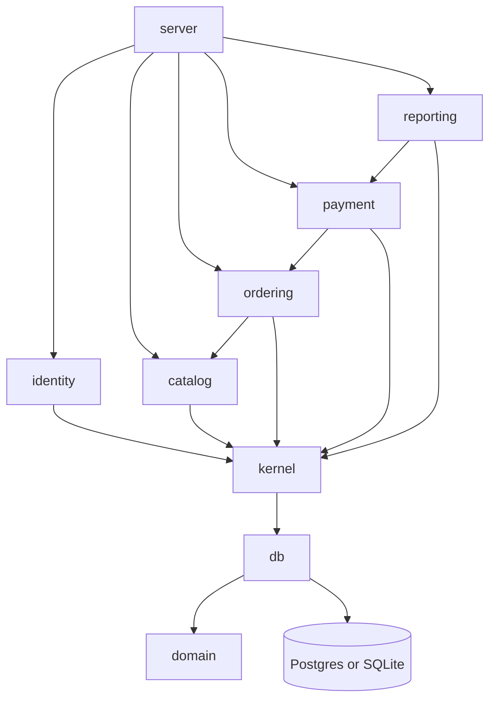

# Architecture

Status: proposed. The code is written after the owner approves this page.

## Choices

| Part | Choice | Why |
| --- | --- | --- |
| Frontend | React, TypeScript, Vite | See below |
| Backend | Rust with axum | The compiler checks every state and error path, which helps both AI and human review |
| ORM | SeaORM | One set of entities for Postgres and SQLite, async, with relations between tables |
| Database | Postgres. SQLite for tests and a one-computer shop | One schema and one migration for both |
| API contract | OpenAPI made from the Rust code, TypeScript types made from OpenAPI | The frontend cannot disagree with the backend without failing the build |
| Delivery | Docker Compose | One command on a shop computer or a cloud server |

### React or Vue

I recommend React. Both can build this product. React has more public code, so AI tools make fewer mistakes with it, and hiring is easier. Vue has less boilerplate in forms. The choice is cheap to change now and costly after T-10.

## Services

The backend is one Rust workspace with one crate for each service.

- `domain` holds business rules. It knows nothing about HTTP or SQL.
- `db` holds the ORM entities and the migration.
- `kernel` holds sign-in, errors, trace IDs, audit and live events.
- Each service crate owns its tables. Only the owner writes them. Others may read them.

A small shop runs all services in one process. A large shop starts the same image several times with `POS_MODULES=ordering,payment` and puts a proxy in front.

### Why not a separate database for each microservice

You asked for services that can connect the tables. Separate databases prevent that. A payment must close the order and free the table together, or not at all. One database does that with one transaction. Separate databases need messages, retries and repair jobs, which are many more ways to lose a sale. A crate boundary lets us split a service out later, when a measured load needs it.

## Trace ID

Every request has one ID in the W3C `traceparent` format. The browser may send it, or the server makes it. It appears in the server log, the `x-trace-id` header, the error shown on screen, the audit log, the order history and the live event. Support asks for the ID on the screen and finds the request.

## PromptPay

The server builds the QR text itself. It needs no bank connection and holds no bank secret. The QR contains the exact amount. Staff confirm the payment after they see the money in the bank app, because a customer's slip can be forged. Automatic confirmation needs a bank contract and is on the later list.

## Security

| Threat | Defence | Story |
| --- | --- | --- |
| Password guessing | Argon2id, a lock after five failures | US-001 |
| Stolen database | Session tokens stored only as a hash | US-001 |
| Request forged from another site | SameSite cookie and a required header | US-001 |
| Employee uses a manager function | The server checks a permission in every handler | T-04 |
| Changed price from the browser | The server reads prices from its own menu | US-008 |
| Same payment sent twice | The browser picks the ID, the database keeps it unique | US-014 |
| Wrong PromptPay receiver | Check-digit validation, admin only, written to the audit log | US-004 |
| Fake customer orders | A secret link for each table, staff must accept, limits | US-019 |
| Script injection | React escaping and a strict content security policy | T-09 |
| Listening on shop Wi-Fi | HTTPS through Caddy, also on a local network | T-09 |
| Vulnerable dependency | `cargo audit` and `npm audit` in CI | T-02, T-10 |

No system is completely safe. These are the threats we design for. A review by an outside tester should happen before a shop stores customers' personal data.

## Tests

| Level | Tool | What it proves |
| --- | --- | --- |
| Unit | `cargo test` in `domain` | Money, states, roles, PromptPay |
| API | `cargo test` through the real router, on SQLite and Postgres | Rules, permissions, two people acting at once |
| Screen parts | Vitest and Testing Library | Forms, translations, error text |
| Whole product | Playwright on a desktop and a phone size | Table, order, kitchen, payment, report |
| Delivery | CI starts Docker Compose | The image runs |

## Where it runs

1. Cloud server: Compose with Postgres and Caddy. Phones and computers use the web address.
2. Local server: the same Compose on one shop computer. Phones use the shop Wi-Fi. The shop works without internet.
3. Phone: the same web app. Cooks use the kitchen screen and customers use the table link.
