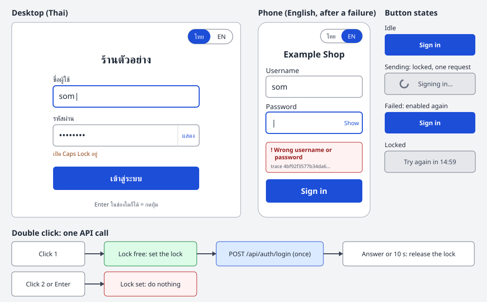
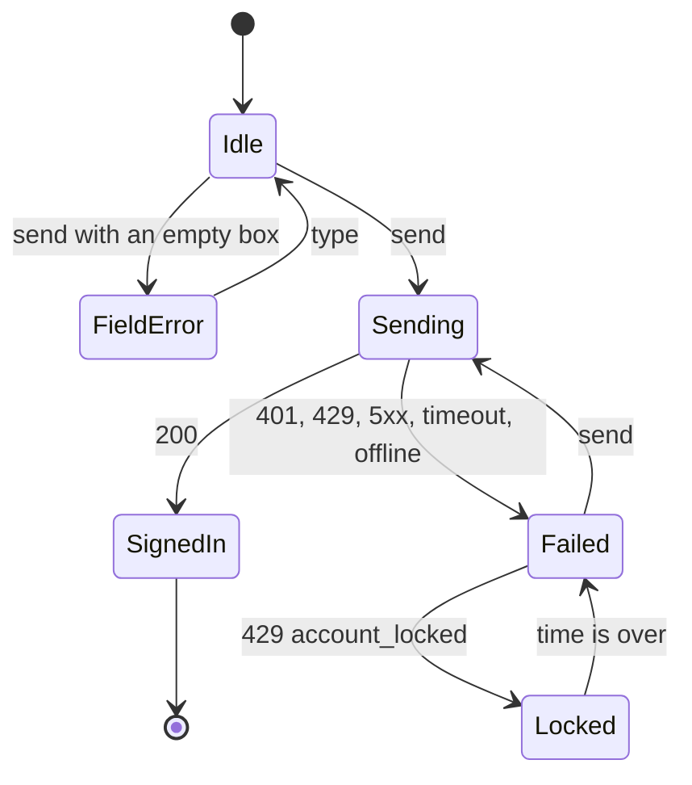

# US-001: Sign in and sign out

Status: draft, not built. This file also shows how much detail every story issue needs.

As an employee, I want to sign in with my username and password, so that each action is recorded under my name and nobody else can use the till.

## Screen



Route `/login`. It is the first screen when nobody is signed in. After sign-in it goes to the page the person asked for, or to Tables.

## Parts of the screen

| Part | Thai | English | Rules |
| --- | --- | --- | --- |
| Language switch | ไทย | EN | Top right. Changes the text at once and keeps what is typed |
| Shop name | From settings | From settings | Falls back to "Thai POS" |
| Username box | ชื่อผู้ใช้ | Username | Focused on open. 3 to 32 characters. Spaces at the ends are removed. Not case sensitive. `autocomplete="username"`, no auto-capital, no spell check |
| Password box | รหัสผ่าน | Password | 8 to 128 characters on creation. Spaces are kept. `autocomplete="current-password"`. Paste is allowed |
| Show password | แสดงรหัสผ่าน / ซ่อนรหัสผ่าน | Show password / Hide password | A 44 px button inside the box. Hidden again when the form is sent |
| Caps Lock note | เปิด Caps Lock อยู่ | Caps Lock is on | Below the password box. Computer keyboards only |
| Sign-in button | เข้าสู่ระบบ | Sign in | Full width, 48 px high. `type="submit"`, so Enter works in both boxes |
| Button while sending | กำลังเข้าสู่ระบบ… | Signing in… | Spinner and text. The width does not change |
| Error area | See Errors | See Errors | Above the button, `role="alert"`, with the trace ID in small text |

There is no "remember me" box and no self sign-up. An admin creates accounts in US-002.

## States



| State | Boxes | Button | Focus |
| --- | --- | --- | --- |
| Idle | Enabled | Enabled | Username |
| FieldError | Enabled, red border and text | Enabled | First wrong box |
| Sending | Read only | Disabled, spinner | Stays |
| Failed | Enabled. Username kept, password cleared | Enabled | Password |
| Locked | Enabled | Disabled with a countdown | Error area |

The button is enabled when the boxes are empty. Pressing it explains what is missing. A disabled button explains nothing.

## One press, one API call

A double click, a double tap, Enter held down, or Enter together with a click must send exactly one request. A second request with a wrong password would also count as a second failure and lock the account too early.

1. The submit handler checks a `useRef` lock before anything else. React state is too late, because two clicks can arrive before the next render.
2. The lock is set before `fetch` and released in `finally`.
3. The button gets `disabled` and `aria-busy="true"` for the eye and the screen reader. It is not the lock.
4. There is no automatic retry of sign-in.
5. The request stops after 10 seconds through `AbortController`, then the person may try again.
6. Leaving the page aborts the request.
7. The server does not trust the browser. Its own lock counts failures in the database.

The lock lives in one hook, `useSubmitOnce`, because payment, send-to-kitchen and every other form need the same rule. Those also send a client-made ID, so that a repeat after a lost reply does nothing. See US-008 and US-014.

## API

`POST /api/auth/login`

Request headers: `content-type: application/json`, `x-pos-client: web`, `traceparent`.

```json
{ "username": "som", "password": "..." }
```

| Status | Body | Meaning |
| --- | --- | --- |
| 200 | `{ "id", "username", "display_name", "role", "permissions" }` and the session cookie | Signed in |
| 401 | `{ "code": "bad_login", "message", "trace_id" }` | Wrong username, wrong password or disabled account. The same answer for all three |
| 422 | `code: "invalid"` | Malformed request |
| 429 | `code: "account_locked"` and `Retry-After` in seconds | Five failures in a row |
| 500 | `code: "internal"` | Our fault |

Cookie: `pos_session`, `HttpOnly`, `Secure`, `SameSite=Strict`, `Path=/`, 12 hours.

`POST /api/auth/logout` deletes the session and the cookie. It answers 204, also when nobody is signed in.

`GET /api/auth/me` returns the same body as a successful sign-in, or 401.

## Errors

| Case | Thai | English |
| --- | --- | --- |
| Empty username | กรุณากรอกชื่อผู้ใช้ | Enter your username |
| Empty password | กรุณากรอกรหัสผ่าน | Enter your password |
| `bad_login` | ชื่อผู้ใช้หรือรหัสผ่านไม่ถูกต้อง | Wrong username or password |
| `account_locked` | บัญชีถูกล็อกชั่วคราว ลองใหม่ใน {time} | Account locked. Try again in {time} |
| Timeout | เซิร์ฟเวอร์ไม่ตอบ กรุณาลองใหม่ | The server did not answer. Try again |
| Offline | ไม่ได้เชื่อมต่อเครือข่าย | No network connection |
| `internal` | ระบบขัดข้อง แจ้งรหัสนี้กับผู้ดูแล | Something failed. Give this code to your admin |

## Security

- Passwords are stored with Argon2id. An unknown username is hashed against a dummy, so both cases take the same time.
- Five failures in a row lock the account for 15 minutes. Success sets the count to zero. The count goes up in one SQL update, so parallel guesses cannot slip past it.
- An `account_locked` answer tells a guesser that the username exists. An unknown username is counted and locked in the same way to hide this.
- The session token is 256 random bits. The database stores its SHA-256.
- The password is never logged, never kept in browser storage and never in a URL.
- Sign-in, failure, lock and sign-out each write an audit row with the trace ID.

## Accessibility and layout

- Every box has a visible label. A placeholder is not a label.
- Order by Tab: language, username, password, show password, button.
- Text contrast is at least 4.5 to 1.
- It works at 320 px wide, with the phone keyboard open, and at 200% zoom.
- Box text is at least 16 px, so iPhones do not zoom in.

## Done when

| # | Check | Test |
| --- | --- | --- |
| 1 | Right username and password open Tables | Playwright, desktop and phone |
| 2 | A double click sends one request | Vitest counts calls. Playwright counts requests on a slow network |
| 3 | Enter and a click together send one request | Vitest |
| 4 | After a failure the button works again | Vitest |
| 5 | After 10 seconds without an answer the timeout text appears and the button works | Vitest with a fake clock |
| 6 | Empty boxes show their text and send no request | Vitest |
| 7 | Unknown user, wrong password and disabled account get identical answers | Rust API test |
| 8 | The sixth try after five failures is refused, even with the right password | Rust API test |
| 9 | Five wrong tries sent in parallel count as five | Rust API test on Postgres |
| 10 | The database contains neither the password nor the cookie | Rust API test |
| 11 | After sign-out the old cookie is refused | Rust API test |
| 12 | The screen error shows the same trace ID as the server log | Playwright |
| 13 | Every text exists in Thai and English | Type check |
| 14 | No accessibility errors | axe in Playwright |

## Not in this story

Creating users, changing or resetting a password, PIN sign-in, two-factor sign-in.

## Split for review

Each row is one issue and one pull request.

| Part | Contains |
| --- | --- |
| US-001a | Password hashing, sessions, login, logout, me. Checks 7 to 11 |
| US-001b | `useSubmitOnce` with its tests. Checks 2 to 5 |
| US-001c | Login screen in Thai and English. Checks 1, 6, 12 to 14 |

## History

| Date | What changed | Why | Issue | PR |
| --- | --- | --- | --- | --- |
| 2026-11-26 | First draft | The owner asked for full detail: text boxes, password, button, and no double API call | #1 | |
