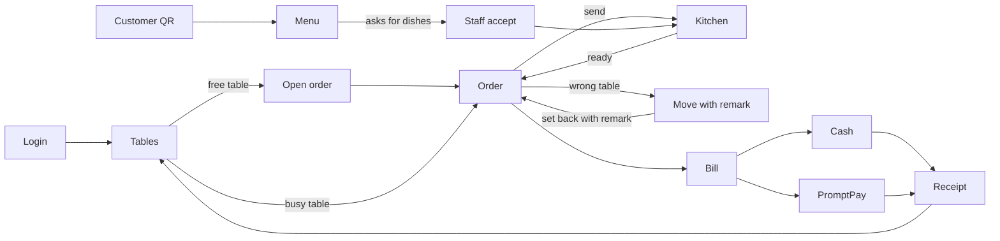

# UX and UI drafts

## How to draft a screen

1. Write the flow as Mermaid text in the story's issue. GitHub draws it.
2. Draw a wireframe in [Excalidraw](https://excalidraw.com). Export it with "Embed scene" as `docs/ux/US-NNN.excalidraw.svg`. GitHub shows it as a picture, and Excalidraw opens the same file for editing.
3. Add the wireframe to the issue and agree on it before code.
4. Build the screen. The Playwright test saves a screenshot in Thai and English, on a desktop and a phone, to `docs/ux/screens/`.
5. The pull request shows the wireframe next to the screenshot.

An AI can read the Mermaid text and the SVG. A person can read the pictures. A Figma link alone gives an AI nothing and can be lost, so Figma is optional.

## Main flow



## Screens

| Screen | Main device | Who |
| --- | --- | --- |
| Sign in | Any | E |
| Tables | Tablet, phone | E |
| Order | Tablet, phone | E |
| Kitchen | Phone, tablet on the wall | E |
| Payment | Tablet, computer | E |
| Menu, tables, reports | Computer | M |
| Users, settings, audit | Computer | A |
| Customer menu | Phone | Customer |

## First wireframe: tables and move

```text
+--------------------------------------------------+
| Thai POS      Tables  Kitchen        ไทย | EN  ⎋ |
+--------------------------------------------------+
| Inside                                           |
| [A1      ] [A2  2 ppl] [A3      ] [A4  4 ppl]    |
| [ free   ] [ 320.00  ] [ free   ] [ 1,150.00]    |
| Garden                                           |
| [G1      ] [G2      ]         [ + Takeaway ]     |
+--------------------------------------------------+

Order A2 > Move
+--------------------------------------------+
| Move order 014 from A2                     |
| To:     (A1) (A3) (G1) (G2)   free only    |
| Remark: [ guests want the garden        ]  |
|                        [Cancel] [Move]     |
+--------------------------------------------+
| History                                    |
| 12:04  A2 to G1  "wants garden"  Som       |
|                               [Set back]   |
+--------------------------------------------+
```

## Rules for every screen

- A finger target is at least 44 px.
- Colour is never the only sign of a state.
- Thai text uses a line height of at least 1.5, so vowels and tone marks are not cut.
- An error shows a translated sentence and its trace ID.
- A change that cannot be undone asks first. Other changes happen at once and can be set back.
